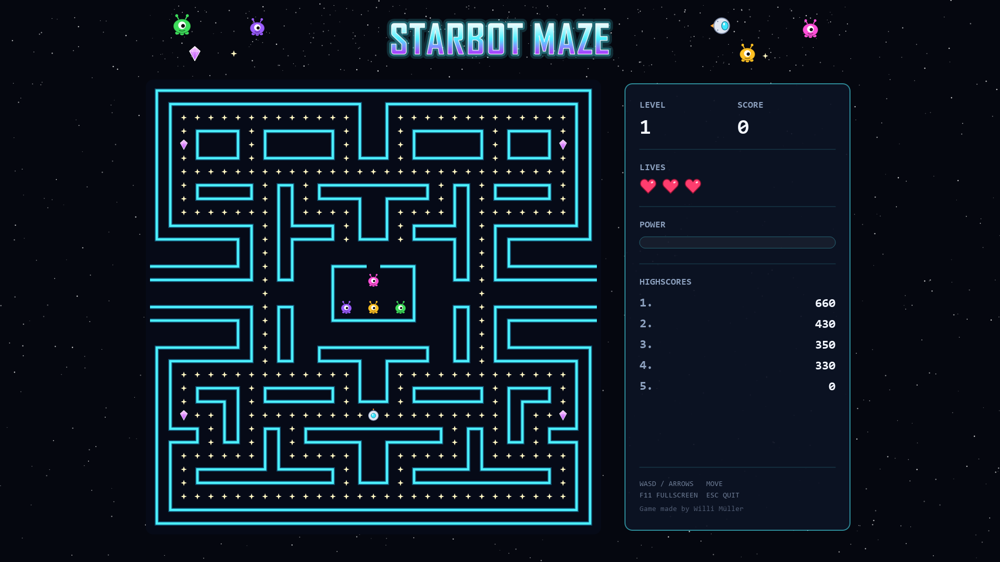

# 🤖 Starbot Maze

**Starbot Maze** is a neon space maze game written in Python with **PyQt5**.
Steer a little robot pod through the maze, collect every star and dodge the aliens.
Grab an energy crystal to freeze them, then catch them for bonus points.



---

## ✨ Features

- 🌌 **Space theme**: neon maze, starry sky, robot pod, one-eyed aliens
- 💎 **Power mode**: energy crystals freeze the aliens so you can catch them
- 📈 **Level progression**: collect all stars and the next level starts
- ❤️ **Lives**: three lives, short invincibility after a hit
- 🏆 **High scores**: the top 10 are saved, the best one is shown in the menu
- 👾 **Alien AI**: aliens hunt you down the shortest path (some more eagerly than others) and flee when frozen
- 💾 **Continue later**: quit mid-game and pick up where you left off with **LOAD** (one save slot, used up when loaded)
- 🔊 **Music & sound**: drop your own files into `logic/music/` and `logic/sounds/`
- 🖥️ **Fits your screen**: detects your resolution (720p to 4K) and starts in fullscreen
- 🎨 **Vector graphics**: all sprites are SVG files and stay sharp at any size
- 🗺️ **Editable map**: the maze is a plain text file

### Scoring

| Item | Points |
|------|--------|
| ✦ Star | 10 |
| 💎 Energy crystal | 100 |
| 👾 Frozen alien | 500 |

---

## 🚀 Installation & Run

Requires **Python 3.10+**.

```bash
python -m venv .venv
.venv\Scripts\activate          # Linux/macOS: source .venv/bin/activate
pip install -r requirements.txt
python main.py
```

VS Code and PyCharm detect the `.venv` folder and use it automatically.

---

## 🕹️ Controls

### Menu

| Key | Action |
|-----|--------|
| `W` / `S` or `↑` / `↓` | Select |
| `Enter` / `Space` | Confirm |
| Mouse | Hover to select, click to confirm |
| `Esc` | Quit |

### Game

| Key | Action |
|-----|--------|
| `W` `A` `S` `D` or arrow keys | Move |
| `R` | Restart after game over |
| `F11` | Toggle fullscreen |
| `Esc` | Quit (saves the game, or the high score after game over) |

---

## 🗂️ Project Structure

```
├── main.py              # start menu (entry point)
├── logic/
│   ├── logic.py         # game window, player, aliens, map, high scores, banner
│   ├── images/          # SVG sprites
│   ├── highscore.txt    # saved high scores
│   ├── savegame.json    # your saved game (created when you quit mid-game)
│   ├── music/           # background music (not included)
│   └── sounds/          # sound effects (not included)
├── game/
│   └── map.txt          # the maze layout
├── requirements.txt
├── TODO.md              # open tasks
└── DEV_TODO.md          # decisions and inputs needed from the developer
```

---

## 🧠 How It Works

- A **QTimer** drives the game loop and updates the player and the aliens every tick.
- Movement is **grid-based**: walls, stars and crystals are tiles read from `game/map.txt`.
- Every sprite is rendered **once** from its SVG at the exact tile size of your screen.
- Aliens use a breadth-first search over the maze to find the shortest way to you.
- Quitting mid-game saves the game to `logic/savegame.json`. After game over the score goes to `logic/highscore.txt`.

---

## 🛣️ Roadmap

- [ ] Difficulty selection
- [ ] Music and sound effect files
- [ ] More maps

See [TODO.md](TODO.md) for details.

---

## 📄 License

© 2026 Willi Müller. All rights reserved.

The source code and all artwork are published for viewing only. No permission is granted to copy, modify or redistribute them without written consent.
